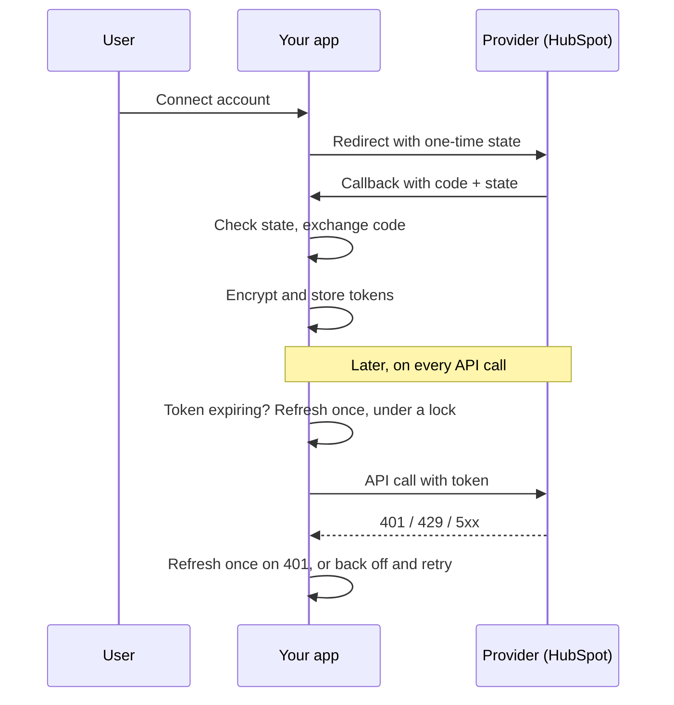

# Integration Starter Kit

Reusable building blocks for connecting your app to third-party APIs (HubSpot, Shopify, Microsoft and others) **safely**: OAuth 2.0 login, encrypted token storage, race-free token refresh, retries and rate limiting.

Every integration project needs the same plumbing, and it's where most of them break. This kit gets that plumbing right once, with tests.

> An original demo project. HubSpot is used as the example provider, and the OAuth settings can be swapped for any other OAuth 2.0 provider.

## What's inside

| Piece | What it does | File |
|---|---|---|
| OAuth 2.0 flow | Consent redirect, one-time `state` check (CSRF protection), code exchange, optional PKCE | `src/oauth/flow.ts` |
| Encrypted token storage | Tokens are stored with AES-256-GCM. Each ciphertext is bound to its tenant, and keys can be rotated | `src/crypto/encryptor.ts`, `src/store/tokenStore.ts` |
| Safe token refresh | Refreshes shortly before expiry, and **only one refresh runs at a time** per tenant (lock), so rotating refresh tokens don't invalidate each other | `src/oauth/tokenManager.ts` |
| API client | Adds the token, refreshes once on `401`, backs off on `429` and `5xx` (honours `Retry-After`), fails fast on real errors | `src/http/apiClient.ts` |
| Retry helper | Exponential backoff with jitter, and a clear split between temporary and permanent errors | `src/util/retry.ts` |
| Rate limiter | Per-tenant request limits with atomic Redis counters | `src/util/rateLimit.ts`, `src/store/redis.ts` |

## How a request flows



## Try it without any accounts

The core logic is covered by tests that need no Redis and no API keys:

```bash
npm install
npm test
```

The 31 tests include: tampered or cross-tenant data is rejected, key rotation keeps old data readable, ten parallel requests trigger exactly one refresh, a 401 triggers one refresh and one retry, and `Retry-After` is respected.

## Run the full app with a real HubSpot account

1. Create a free [HubSpot developer account](https://developers.hubspot.com) and a **public app**. In its Auth tab, copy the Client ID and Client Secret, add the redirect URL `http://localhost:3000/auth/callback`, and add the scope `crm.objects.contacts.read`.
2. Create your settings file and fill it in:
   ```bash
   cp .env.example .env
   npm run gen-key        # paste the output as TOKEN_ENCRYPTION_KEY
   ```
3. Start it:
   ```bash
   docker compose up --build
   ```
4. Open `http://localhost:3000/auth/acme/connect` in your browser, where `acme` is any tenant name. Approve the HubSpot consent screen.
5. Check the result:
   - `http://localhost:3000/api/acme/status` shows the connection (tokens are never returned)
   - `http://localhost:3000/api/acme/contacts` fetches 5 contacts, refreshing the token automatically when needed

## Endpoints

| Method | Path | Purpose |
|---|---|---|
| GET | `/auth/:tenant/connect` | Starts the OAuth flow |
| GET | `/auth/callback` | Receives the provider's redirect |
| GET | `/api/:tenant/status` | Connection status and expiry time |
| GET | `/api/:tenant/contacts` | Example API call through the managed client |
| DELETE | `/auth/:tenant` | Removes a tenant's stored tokens |

## Design notes

- **Why a lock around refresh?** Providers like HubSpot can rotate the refresh token. If two requests refresh at the same time, one of them ends up holding a dead token. The lock plus a re-check after acquiring it avoids that.
- **Why `rejectedToken`?** When a request gets a 401, it reports which token failed. If another request has already replaced it, the new token is used directly instead of refreshing a second time.
- **Why is the tenant in the encryption context?** A stored value copied from tenant A's record to tenant B's can't be decrypted, which limits the damage of a database mix-up.
- **Why separate temporary and permanent errors?** Retrying `429` and `5xx` helps. Retrying a `400` just wastes time and can hammer an API.

## Known limits (honest list)

- The demo routes have no login of their own. In a real product, protect `/auth/*` and `/api/*` with your own authentication and make sure users can only reach their own tenant.
- Fixed-window rate limiting allows short bursts at window edges. A token bucket or sliding window would be smoother.
- Key management uses environment variables. For production, consider a managed key service (AWS KMS, for example) behind the same `TokenEncryptor` interface.

## Tech stack

Node.js 20, TypeScript, Express, Redis, Docker, built-in `node:test`

## Need something like this?

I build reliable integrations between Shopify, WooCommerce, HubSpot, Dynamics 365 and other business tools.
[LinkedIn](https://www.linkedin.com/in/astha-p-shukla-b398b2213) · astha.61097@gmail.com
